# 🚗 ONE2CAR - Car Marketplace Selling Website

ONE2CAR is a featured car selling web application that allows users to browse, list, and manage car listings. Dealers and individual sellers can register and post vehicles for sale, while buyers can filter and view listings with detailed specifications and images.

---

## 🛠️ Tech Stack

- **Frontend**: HTML, CSS, JavaScript
- **Backend**: Node.js + Express.js
- **Database**: MySQL

---

## 🔑 Features

- 🚗 Post car listings with images, price, and specs
- 🔍 Search and filter cars by name, brand, model and seller type
- 🧾 Detailed car listing pages
- 🛠️ Admin dashboard for managing listings and users
- 📱 Responsive UI for desktop

---

## 📦 Installation

```bash
# Clone the repository

# Install dependencies
npm install cors
npm install express
npm install mysql2
npm install dotenv

# Set up environment variables
DB_HOST=localhost
DB_USER=root
DB_PASSWORD=YOUR _DB_Password #<-- YOUR DB Password
DB_NAME=USEDCAR3
# Edit .env to match your configuration

# Start the server, you need to open 2 terminals
- In Frontend folder
cd ./sec1_gr12_fe_src
npm start
- In Backend
cd ./sec1_gr12_ws_src
npm start
```
## 📦 Demo
1. Open terminal. </br> 
2. Add another terminal. </br> 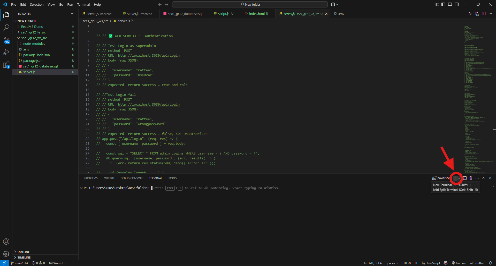
3. For the first terminal, key `cd .\sec1_gr12_fe_src\` and then `npm start`. </br> 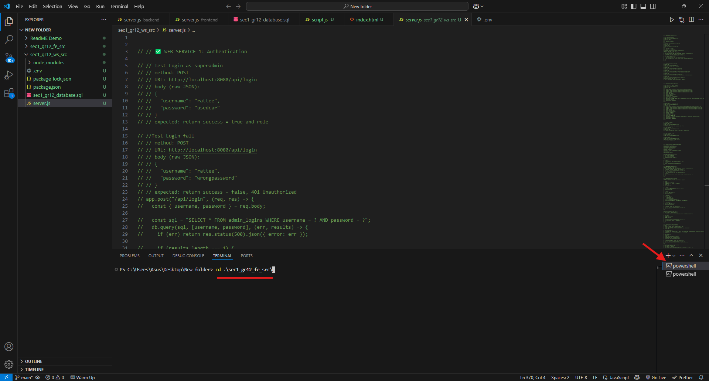 </br> and output should be like this </br> 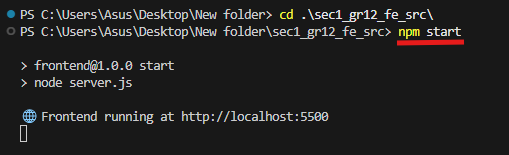 
4. For the second terminal, key `cd .\sec1_gr12_ws_src\` and then `npm start`. </br> 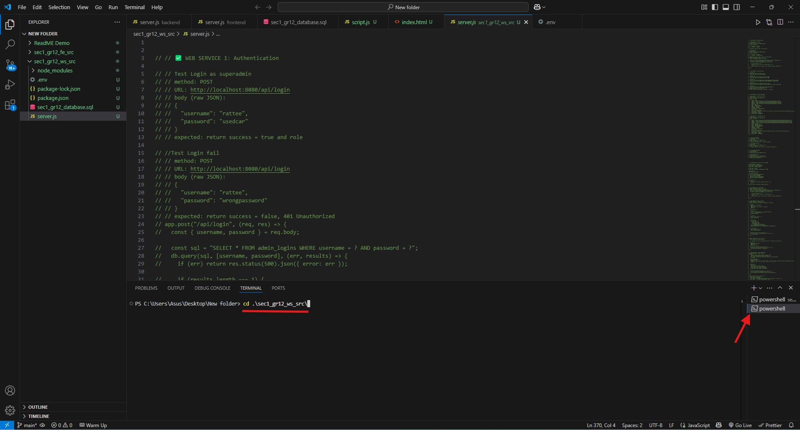 </br> and output should be like this </br> 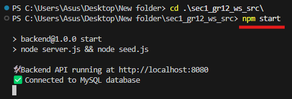
5. In website(use frontend port), this is the homepage </br> 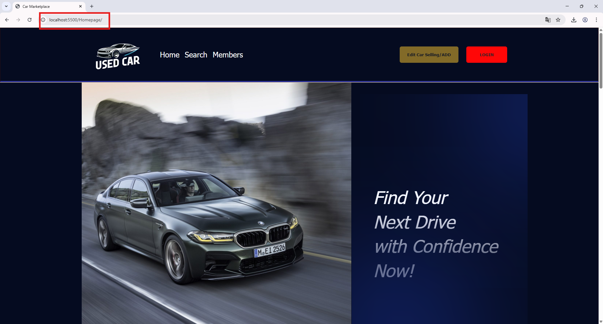
6. If you want to be able to use "Edit Car Selling/ADD" button. </br> 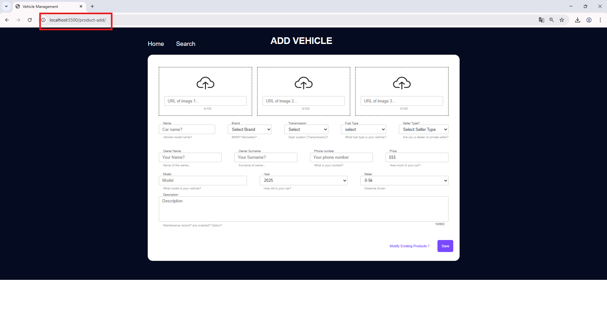 </br> First you have to login. </br> 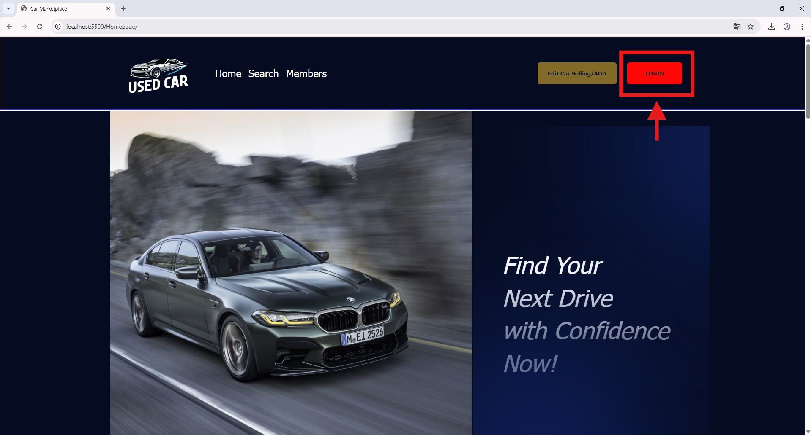 
7. After you logged in, you will sent to homepage with navigate bar include of search, member and logout. </br> 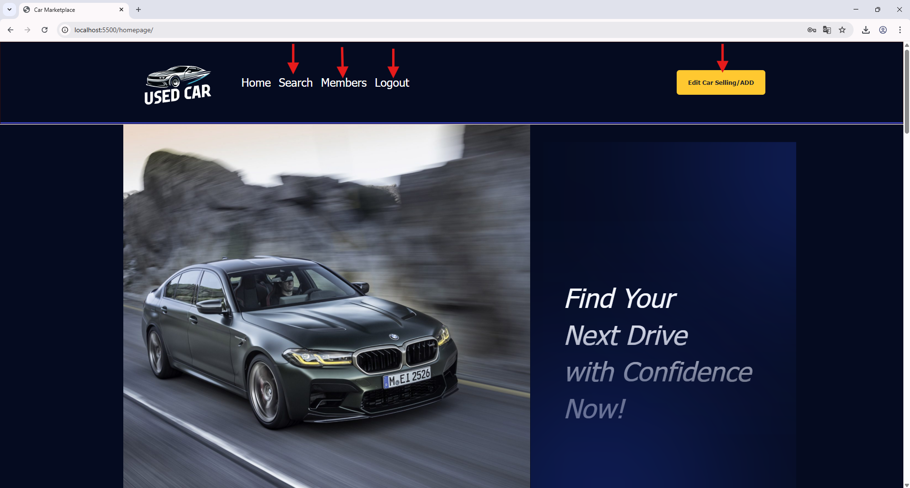
8. For searching page, you can specify the criteria of product you want such as name, model, brand and seller type. </br> 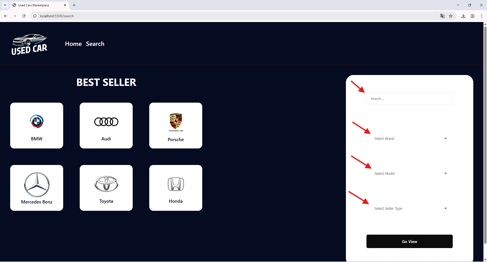 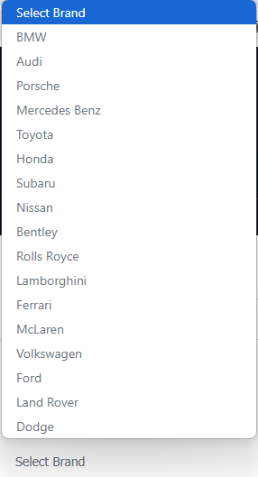 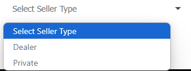
9. When you click "Go View", you will sent to searching result page and you can select the available product to view the detail. </br> 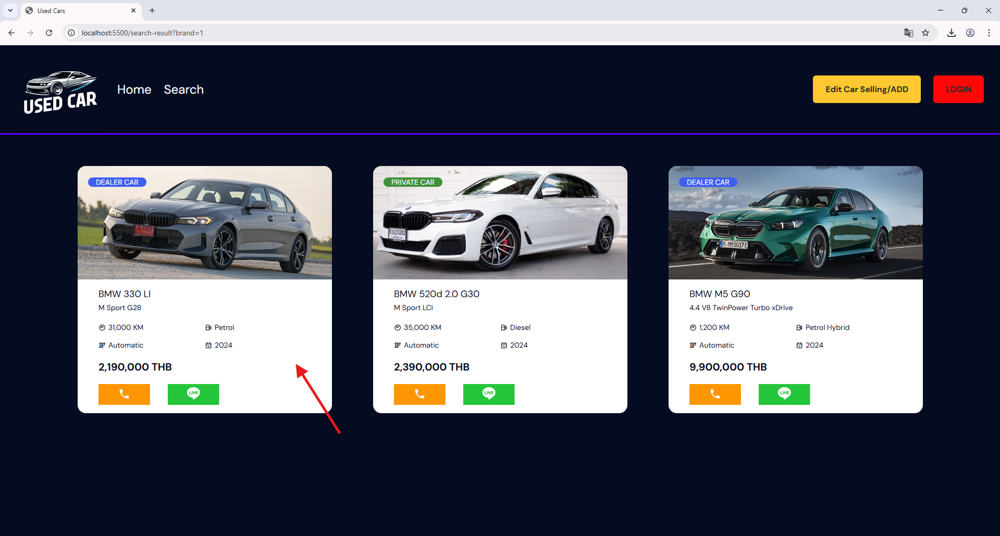
10. In detail page, you can edit/update that specific product. </br> 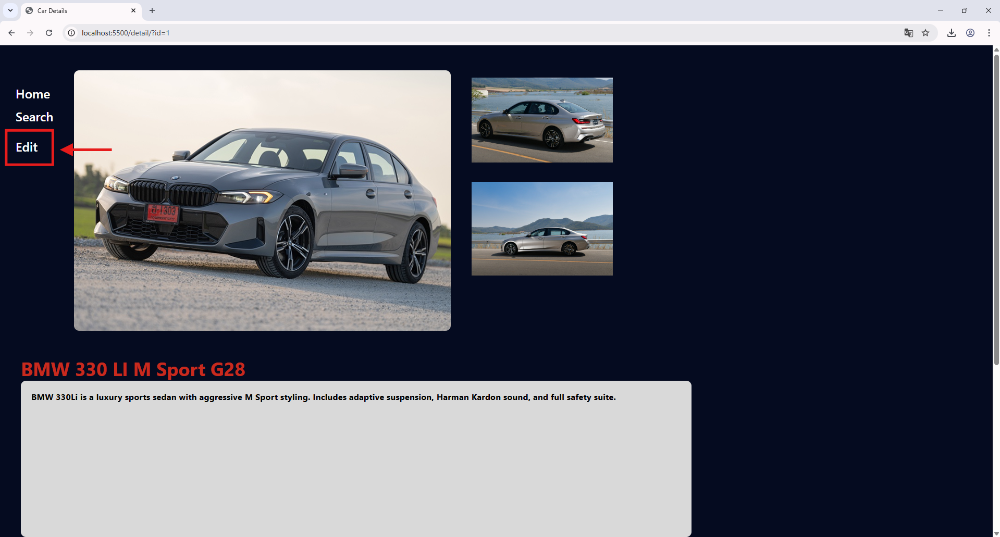 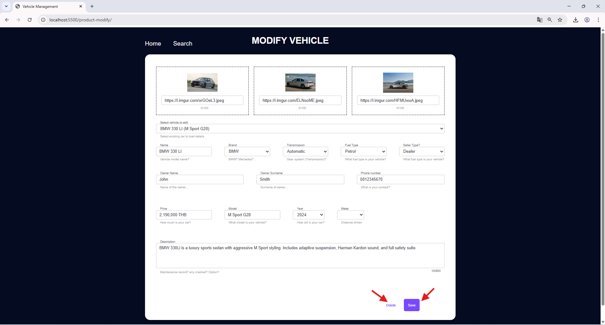
