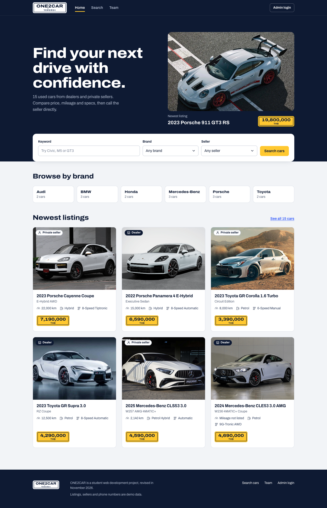
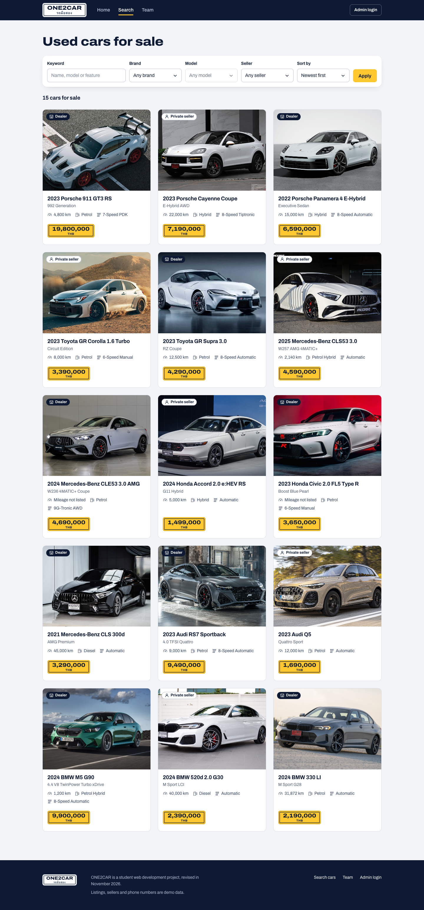
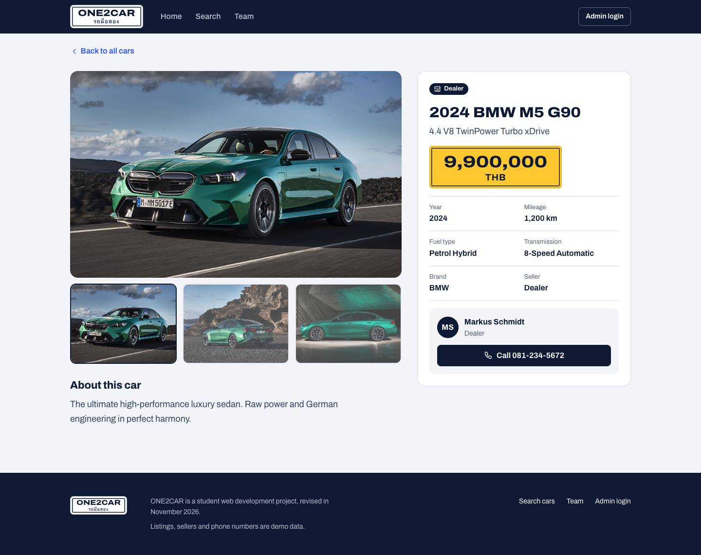
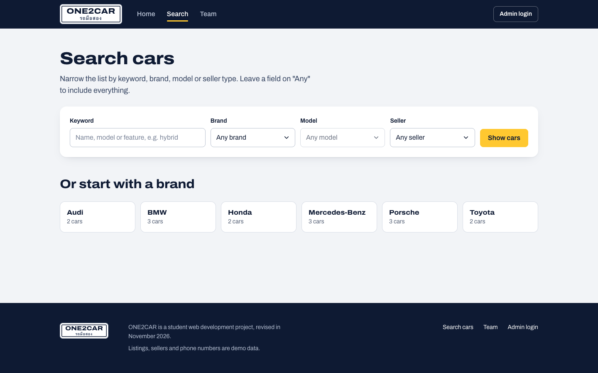
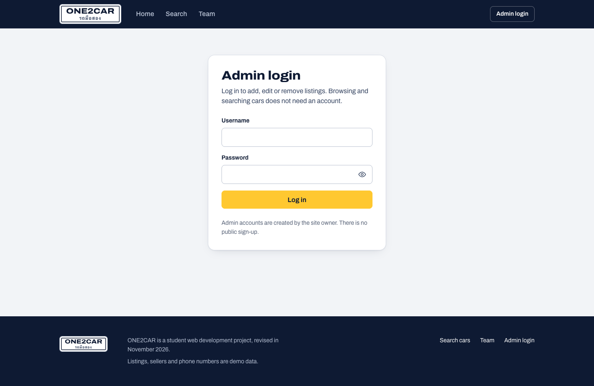
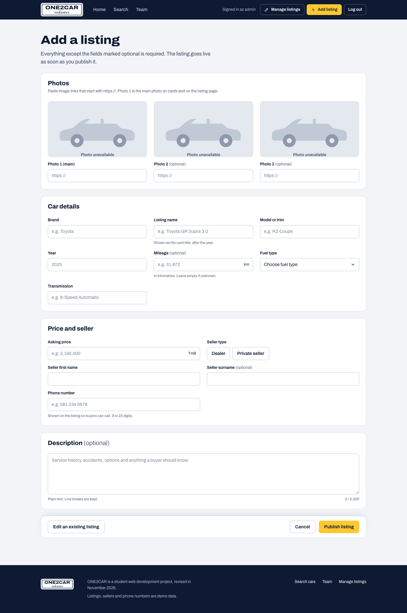
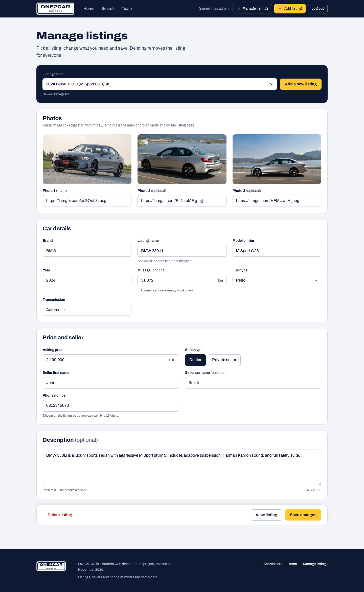
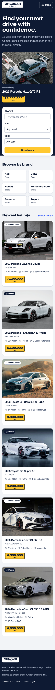
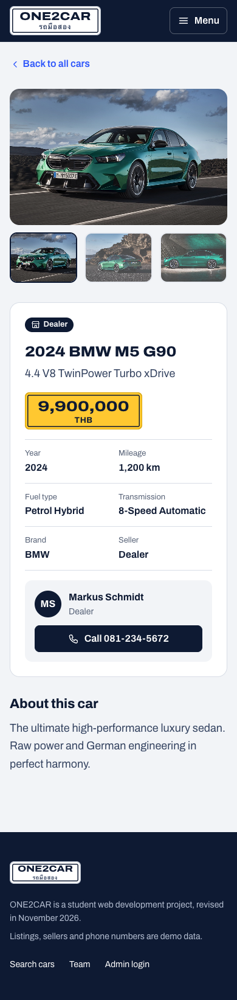
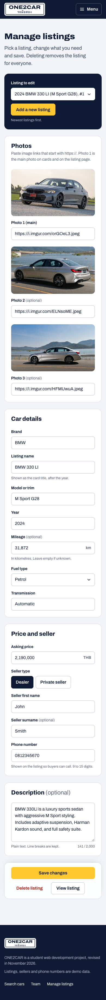

# ONE2CAR – used car marketplace

ONE2CAR is a used-car listing site built by a four-person student team as a web development course project, and revised in November 2026. Visitors browse and search cars from dealers and private sellers, open a listing to see photos, specs and the seller's phone number, and call the seller. Admins log in to add, edit and delete listings.

The listings in the seed data are demo data: the seller names and phone numbers are fictional.



## Screenshots

| Search results | Listing page |
| --- | --- |
|  |  |

| Search | Admin login |
| --- | --- |
|  |  |

| Add a listing (admin) | Manage listings (admin) |
| --- | --- |
|  |  |

On a phone (390 px wide):

| Home | Listing | Edit form |
| --- | --- | --- |
|  |  |  |

More captures, including every page at 390 px, are in [`ReadME_Demo/2026/`](ReadME_Demo/2026/).

## Features

**For buyers (no account needed)**

- Home page with the newest listing, brand shortcuts and the six next-newest cars.
- Search by keyword, brand, model and seller type (dealer or private), with sorting by newest, price, model year or mileage. Keywords match any part of the brand, name, model, year, fuel, transmission or description, and every word must match.
- Results page with removable filter chips and an empty state that suggests what to change.
- Listing page with a photo gallery, price, specs, description and a "Call" button with the seller's number.
- Brand tiles that open the matching results.
- Works on phones: one column layout, a collapsible menu and full-width buttons.

**For admins**

- Login with username and password. Passwords are stored as scrypt hashes; a login lasts 30 minutes by default.
- Add a listing: up to three photo links with live previews, required-field checks, formatted price and mileage inputs.
- Manage listings: pick any listing, edit it with its current values filled in, or delete it after a confirmation dialog.
- Every change is checked again by the API, so a direct API call cannot skip validation.

## How it is built

```
Browser ──> Frontend/server.js (Express, port 5500)
              serves the 8 HTML pages + Frontend/shared/ (CSS, JS, images)
              and /config.js, which tells the pages where the API is
   │
   └──fetch──> Backend/server.js (Express REST API, port 8080)
                 mysql2 connection pool ──> MySQL database (DB_NAME, default "one2car")
```

- **Front end:** plain HTML, CSS and JavaScript modules. No framework and no build step.
  - `Frontend/shared/one2car.css` is the only stylesheet. It imports `css/tokens.css` (colours, type, spacing), `base.css`, `layout.css` (header, footer), `components.css` (buttons, cards, forms, toasts, dialog) and `pages.css`.
  - `Frontend/shared/app.js` holds the API client, login session helpers, formatting, toasts and the shared header and footer. `Frontend/shared/listing-form.js` is the add/edit form used by both admin pages.
  - Each page folder (`Homepage`, `searchpage`, `searchpage-result`, `Detail`, `Login`, `product-add`, `product-modify`, `member`) contains only `index.html` and `script.js`.
  - Text from the database is always inserted with `textContent`, never as HTML.
- **Back end:** Express 5 with `mysql2`. `lib/cars.js` validates listings and holds the column whitelist, `lib/auth.js` handles scrypt hashing and session tokens, `lib/db.js` builds the pool and explains connection errors.
- **Database:** `Backend/db/schema.sql` (tables `cars`, `admin_users`, `sessions`) and `Backend/db/seed-cars.sql` (15 demo cars). Prices are whole baht and mileage is whole kilometres.

### API

| Method | Path | Who | What it does |
| --- | --- | --- | --- |
| GET | `/api/cars` | anyone | List cars. Optional query: `q`, `brand`, `model`, `type` (`dealer` or `private`), `sort` (`newest`, `price_asc`, `price_desc`, `year_desc`, `mileage_asc`) |
| GET | `/api/cars/:id` | anyone | One car, or 404 |
| GET | `/api/brands` | anyone | Brands with listing counts: `[{ "name": "BMW", "count": 3 }]` |
| GET | `/api/models?brand=BMW` | anyone | Models for a brand |
| POST | `/api/login` | anyone | `{ username, password }` returns `{ token, role, username, expiresAt }` |
| GET | `/api/session` | logged in | Checks a token |
| POST | `/api/logout` | logged in | Ends the session |
| POST | `/api/cars` | admin | Create a listing (all required fields) |
| PUT | `/api/cars/:id` | admin | Update any subset of fields |
| DELETE | `/api/cars/:id` | admin | Delete a listing |

Admin requests send `Authorization: Bearer <token>`. Only the SHA-256 of each token is stored, in the `sessions` table. Errors come back as `{ "error": "message" }`; validation errors also name the `field`. Server errors return a generic message and the details go to the server log.

Listing fields: `brand`, `name`, `model`, `year`, `price`, `mileage` (optional), `fuelType`, `transmission`, `type`, `image_1` (main photo), `image_2`, `image_3` (optional), `description` (optional), `owner_name`, `owner_surname` (optional), `phone_number`.

## Run it locally

You need **Node.js 20 or newer** and **MySQL 8 or newer** running locally. (Tested with Node 22 and MySQL 9.2.)

### 1. Configure the API

```bash
cd Backend
cp .env.example .env        # Windows: copy .env.example .env
```

Open `Backend/.env` and set:

- `DB_USER` and `DB_PASSWORD`: a MySQL account that may create a database (for example your local root account).
- `ADMIN_USERNAME` and `ADMIN_PASSWORD`: the admin login you want for the site (password: at least 10 characters).

The other values work as they are. The API uses its own database, `one2car` by default (`DB_NAME`).

### 2. Install, create the database and start the API

```bash
npm ci
npm run seed
npm start
```

`npm run seed` creates the database and tables if they are missing, adds the 15 demo cars if the `cars` table is empty, and creates or updates the admin account. It never drops tables or data, so it is safe to run again (for example to change the admin password).

The API prints `ONE2CAR API listening on http://localhost:8080`. If MySQL is not reachable it stops with a message that says what to fix.

### 3. Start the website (second terminal)

```bash
cd Frontend
npm ci
npm start
```

Open <http://localhost:5500>. To manage listings, click **Admin login** and use the admin account from `.env`.

### Optional settings

| Variable | Where | Default | Purpose |
| --- | --- | --- | --- |
| `BACKEND_PORT` | Backend/.env | `8080` | API port |
| `FRONTEND_ORIGIN` | Backend/.env | `http://localhost:5500,http://127.0.0.1:5500` | Browser origins allowed by CORS |
| `SESSION_TTL_MINUTES` | Backend/.env | `30` | How long an admin login lasts |
| `DB_SOCKET` | Backend/.env | not set | Connect through a Unix socket instead of host and port |
| `API_BASE_URL` | environment of `Frontend/` | `http://localhost:8080` | Where the pages send API requests |
| `FRONTEND_PORT` | environment of `Frontend/` | `5500` | Website port |

If you change the website port or host, add the new origin to `FRONTEND_ORIGIN` as well.

## What changed in the 2026 revision

- **Security:** fixed SQL injection in `PUT /api/cars/:id` (request keys were used as column names) with a column whitelist and validation; passwords are scrypt hashes instead of plain text; admin actions need a server-issued token that expires; CORS is limited to the website's origin; database errors are no longer sent to the browser; listing text can no longer inject HTML (stored XSS); a login that sat in a code comment was removed.
- **Data:** the 15 demo cars are restored (they were commented out) with their brand, and price and mileage are stored as numbers. The seed no longer runs `DROP DATABASE`, and `npm run seed` replaces the missing `seed.js`.
- **Bugs:** add-form photos were saved in the wrong fields; the edit form blanked mileage, transmission and year because its dropdowns did not contain the saved values; the add form reported success even when saving failed; `/detail` broke on case-sensitive systems; missing values crashed the results and listing pages; search called an API route that did not exist; home page cards were not clickable.
- **Interface:** one design system shared by every page (it replaces eight separate stylesheets), the same header and footer everywhere, mobile layouts, keyboard focus styles, labelled form fields, inline messages instead of `alert()` pop-ups, and a local placeholder image when a photo link is broken. Buttons that did nothing (Forgot, Sign Up, Call/LINE images) were removed; show-password and brand shortcuts now work.
- **Removed:** the third-party `gptengineer.js` editor script, placeholder social-preview images and hot-linked temporary images.

## Team

Rattee Watperatam, Naruebordint Veangnont, Nichakan Ninhusrungsri and Nattapat Krisanasamit.
